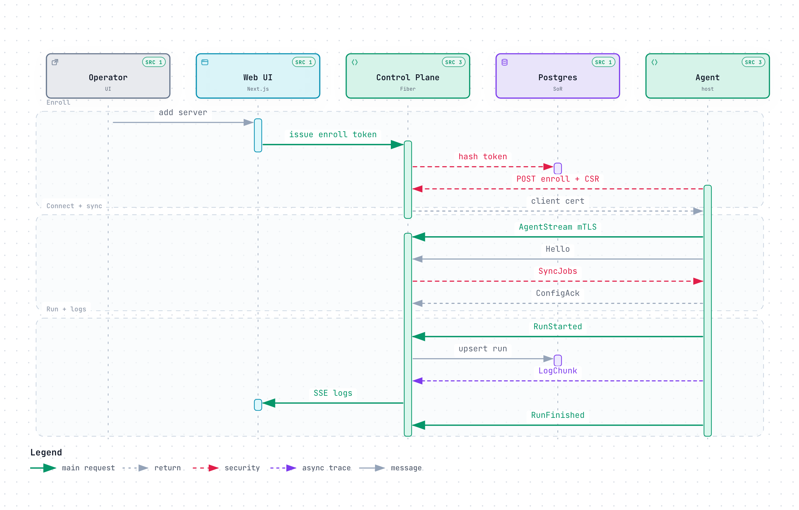
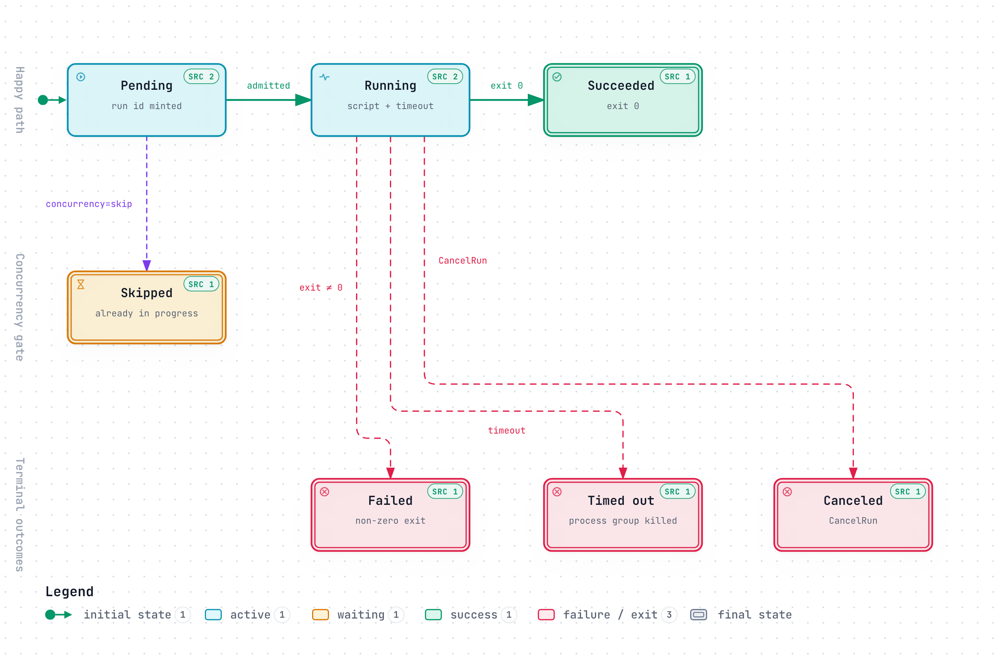
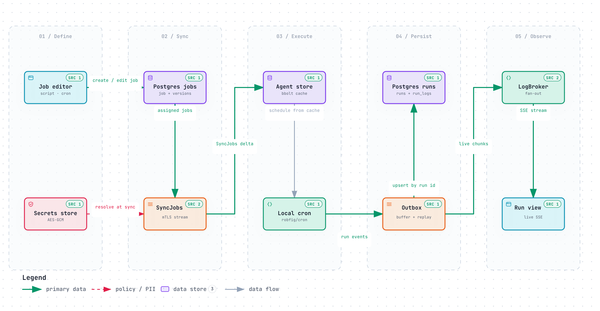

# Diagrams

Interactive Archify diagrams for CronCompose architecture, sequences, lifecycles, and data flow. PNGs below are static previews; open the linked HTML for pan / theme / source links (download the HTML from this wiki and open it locally in a browser).

In a running control plane, the signed-in **Architecture** page also embeds the runtime map at `/app/architecture`.

---

## Runtime architecture

Public marketing surface, signed-in deploy path, and mTLS agents.


[Interactive HTML](html/runtime-architecture.html) · Source: control plane, agent, and web UI (see repo `docs/architecture.md`)

**What to look for**
- Control plane host vs managed Linux server boundaries
- Session + role gates on the REST surface
- Agents dial **out** over mTLS; deploys and connector logs stay on that stream

---

## Agent enroll, sync, and run

One-time REST enroll, then mTLS stream for job sync and live logs.



[Interactive HTML](html/agent-job-sequence.html) · Related: [Agent Protocol](Agent-Protocol.md) · [How it Works](How-it-Works.md)

**Phases**
1. **Enroll** — operator mints a token; agent exchanges CSR for a client cert
2. **Connect + sync** — `AgentStream`, `Hello`, `SyncJobs`, `ConfigAck`
3. **Run + logs** — local cron → `RunStarted` / `LogChunk` / `RunFinished` → SSE to the UI

---

## Job run status lifecycle

Agent-originated runs: admit, execute, terminate.



[Interactive HTML](html/run-status-lifecycle.html) · Related: [Data Model](Data-Model.md) · ADR-001 in [Design Decisions](Design-Decisions.md)

| Status | Meaning |
|--------|---------|
| `pending` | Run id minted |
| `running` | Script executing under timeout / limits |
| `succeeded` | Exit 0 |
| `skipped` | Concurrency policy `skip` while already in progress |
| `failed` / `timed_out` / `canceled` | Terminal error paths |

---

## Job definition and log data flow

Definitions flow down; runs and logs flow up — offline-safe.



[Interactive HTML](html/job-logs-dataflow.html) · Related: [Architecture](Architecture.md) · [Security](Security.md)

**Left → right**
1. Job editor + secrets → Postgres definitions
2. `SyncJobs` over mTLS → agent bbolt cache
3. Local cron executes → outbox buffers events
4. Upsert into Postgres → `LogBroker` → SSE run view

---

## ASCII topology (quick reference)

```
+---------------------------------------------------------------+
|                        Control Plane                          |
|   Next.js UI  --REST/SSE-->  Fiber API  <-->  PostgreSQL      |
|                                  ^                            |
|                                  | gRPC bidi stream (mTLS)    |
+----------------------------------|----------------------------+
                                   |  (agents always dial OUT)
              +--------------------+--------------------+
              |                    |                    |
       Raspberry Pi             EC2                bare-metal
```

---

## Regenerating

Diagrams are authored as Archify candidates under `.archify/` in the main repository and finalized with the Archify CLI (`architecture`, `sequence`, `lifecycle`, `dataflow`). PNGs and HTML in this folder (`docs/wiki/diagrams`, `docs/wiki/html`) are the in-repo copies; the same assets are published on the GitHub wiki.
