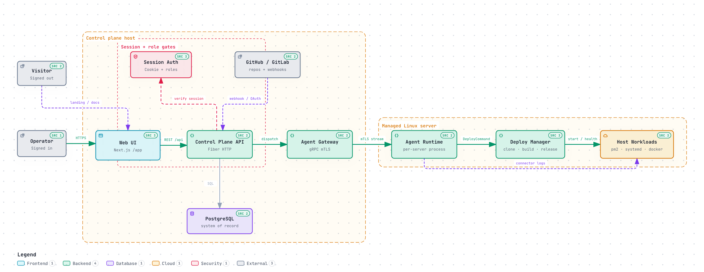

# CronCompose

CronCompose is a **self-hosted control plane** for writing, scheduling, and managing cron-style jobs across remote Linux machines — Raspberry Pi, EC2, bare metal, or any Linux box. You write a shell script in the web UI, set a schedule (for example “every 6 hours”), pick the server it runs on, and CronCompose deploys it, runs it on time, and shows live logs and run history.

**Repository:** [workvar/cron-compose](https://github.com/workvar/cron-compose)  
**Current release:** [v0.0.3](https://github.com/workvar/cron-compose/releases/tag/v0.0.3) — see [Releases](Releases.md)

### Architecture at a glance



[All diagrams](Diagrams.md) · [Architecture](Architecture.md) · [Design decisions](Design-Decisions.md) · [How it works](How-it-Works.md)

## Why it exists

Classic cron lives on each box: `crontab -e`, no history, no live logs, and no way to manage a fleet from one place. Hosted job runners assume inbound access to the worker, which fails for a Pi behind a home router. CronCompose is built for the other case:

| Need | What CronCompose does |
|------|------------------------|
| One place to write jobs | Web UI + REST API + `cc` CLI |
| Servers behind NAT / firewalls | Agents **dial out**; no inbound ports on targets |
| Flaky links and outages | Agent-local scheduler — jobs keep firing offline |
| Visibility | Run history, exit codes, durations, live SSE logs |
| Safety | RBAC, encrypted secrets, audit log, mTLS agent identity |
| Self-hosting | One small VM (or Pi) for the control plane; agents are a single binary |

It is **not** a CI/CD system, a DAG orchestrator, or a SaaS. It is a single-tenant, self-hosted operations tool.

## Who it is for

- Homelab and Raspberry Pi operators who want a real UI for jobs that used to live in crontab.
- Small teams running Linux boxes (edge, kiosks, backup hosts) that should keep working when the control plane is unreachable.
- Operators who also want to inspect nginx, systemd, Docker, and pm2 on those same hosts from one portal.

## Two halves

1. **Control plane** — Next.js web UI, Go (Fiber) REST API, PostgreSQL. Define servers, write jobs, read logs.
2. **Agent** — a small Go binary on each target. It dials *out* over mTLS gRPC, caches job definitions locally, runs its own cron, and streams results back.

The control plane is the source of truth for **definitions**. Execution does not depend on a live connection.

```
  Browser  ──HTTP──►  Control plane (:8080  /app + /api)
                         ▲
                         │ mTLS gRPC (:9090)
                         │  agents always dial OUT
              ┌──────────┴──────────┐
           Pi (home)    EC2      bare-metal Linux
```

## Quick start

```sh
git clone https://github.com/workvar/cron-compose.git
cd cron-compose
./install/install.sh
```

Open the printed URL (it redirects to `/app/landing`), sign in with the admin you created (lands on `/app`), add a server, and paste the install command on the target. Details: [Installation](Installation.md).

## Wiki map

| Page | What’s on it |
|------|----------------|
| [How it works](How-it-Works.md) | End-to-end flow: enroll, sync, schedule, run, logs |
| [Architecture](Architecture.md) | Components, topology, scheduling model, transport |
| [Installation](Installation.md) | From-source installer (`--advanced` for OIDC), Docker Compose, agent install |
| [Compatibility](Compatibility.md) | OS, runtimes, architectures, connectors, limits |
| [Deployment](Deployment.md) | Production topology, TLS, env, hardening |
| [Security](Security.md) | Auth, RBAC, mTLS, secrets, threat model |
| [Development](Development.md) | Local setup, make targets, repo layout |
| [REST API](REST-API.md) | HTTP surface for the UI and external callers |
| [CLI](CLI.md) | `cc` command reference |
| [Agent protocol](Agent-Protocol.md) | Enrollment, gRPC messages, local scheduler |
| [Connectors](Connectors.md) | nginx, systemd, Docker, pm2 from the portal |
| [Web terminal](Web-Terminal.md) | Browser PTY on enrolled servers |
| [Data model](Data-Model.md) | Postgres entities |
| [Operations](Operations.md) | Metrics, OIDC (`--advanced` / `.env`), agent packages, retention |
| [Releases](Releases.md) | Version history and upgrade notes |
| [Roadmap](Roadmap.md) | What’s shipped and what is not |

Source-of-truth design docs also live in the repo under [`docs/`](https://github.com/workvar/cron-compose/tree/main/docs). This wiki is the public guide; those files are the detailed spec.
